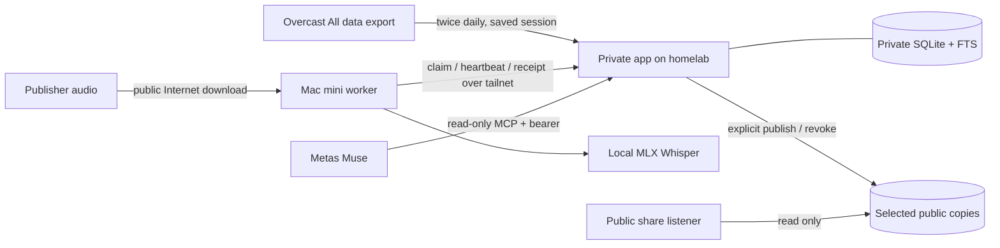

# Transcripts

A private podcast transcript library: Overcast discovery, local MLX Whisper on the
Mac mini, full-text search and timestamped reading, and a read-only HTTP MCP server.
Built for `transcripts.merimerimeri.com` on the tailnet. Homelab hosts the app and
SQLite; the mini pulls work over HTTP, so inference stays local without SSH jobs.

Astra reviewed the [architecture](docs/architecture.md) before implementation.
Its [review](docs/astra-plan-review.md) records the required privacy and durability
boundaries. [Operations and deployment](docs/operations.md) cover the actual rollout.



## Start on the mini

```sh
uv sync --extra worker --extra dev
uv run transcripts init
uv run transcripts serve
```

`init` creates four independent random secrets in a mode-0600 `.env`, without
printing them. Open <http://127.0.0.1:8765> in a normal browser and sign in with
`OWNER_TOKEN` from that file. It stays signed in for 30 days. Configure a different
port together with `APP_ORIGIN`; exact Host and Origin checks are intentional.

On **Connections**, choose **Connect with Overcast app**, scan with your iPhone
camera, and approve in Overcast. Only its `o` session cookie is saved in
`data/overcast.json`. Email/password login and hidden cookie import are fallbacks;
passwords are never stored. Automatic discovery begins within a minute and polls
at most twice daily. This is an unofficial connector: changed exports or expired
sessions are visible on Pipeline.

In a second terminal, start the worker (reads the separate `WORKER_TOKEN`):

```sh
uv run transcripts worker --url http://127.0.0.1:8765
```

The default is `mlx-community/whisper-large-v3-turbo-q4` (multilingual, 4-bit quantized large-v3-turbo; about 25x real time on an M4). First use downloads
the model from Hugging Face; subsequent inference runs on Apple silicon. `ffmpeg`
must be installed. The Linux server does not install or run MLX. Set
`WHISPER_MODEL` locally to change the model; jobs cannot choose shell commands,
paths, or models. The worker starts one killable inference process at a time.

For an interface preview with **fictional sample content in a separate database**:

```sh
uv run transcripts demo
uv run transcripts --env .env.demo serve --port 8766
```

The demo command prints a demo-only key. Never connect the demo to your account.
The real library starts empty; no fabricated podcasts are mixed into it.
For an assisted one-time phone approval from the local checkout, run
`uv run python scripts/connect_overcast.py`; open its private QR image and scan
it. The helper deletes the image after approval or expiry.

## Discovery behavior

The extended export carries source IDs, played status, partial progress, activity
timestamps, feeds, and audio URLs. Plain subscription OPML is rejected.

- First successful import stores all valid episode inventory, but queues only
  qualifying activity dated within the last seven days, at most 20 per check.
- Completed/marked-played episodes qualify, as do episodes with at least five
  minutes of progress. “Played” can mean manually marked played.
- Unknown/invalid/future dates and older entries stay in unprocessed history.
  Choose an episode and click **Transcribe this episode**, or use bounded backfill.
- Later imports queue recent newly observed episodes and observed progress/played
  transitions. Metadata edits and repeated exports do not create duplicate work.
- Missing entries never remove existing history or transcripts. `userUpdatedDate`
  is a state-change timestamp, not an exact listening date; the export is a snapshot
  of retained state, not proof of every historical listen.

```sh
uv run transcripts import /path/to/overcast-all-data.opml
uv run transcripts backfill --limit 10          # preview only
uv run transcripts backfill --limit 10 --commit
uv run transcripts status
uv run transcripts doctor
```

The site supports full-text passage search, podcast/status filters, paginated
reading with stable passage anchors, find within a page, text download, queue and
retry actions, and discovery/worker health. Dates display in `America/New_York` by
default; override `DISPLAY_TIMEZONE` with an IANA timezone name.

## MCP for Metas Muse

Supported contract: **Streamable HTTP + Authorization bearer header**. Configure
Muse with the endpoint and **MCP_TOKEN**, never the owner or worker token:

```text
https://transcripts.merimerimeri.com/mcp
Authorization: Bearer <MCP_TOKEN>
```

See [client configuration example](deploy/muse-mcp.example.json); adapt its exact
wrapper to Muse's settings. Environment-variable expansion is client-specific.
The six tools are `search_transcripts`, `list_podcasts`, `list_episodes`,
`get_transcript`, `listening_history`, and `pipeline_status`. Reading returns
`next_offset`; follow it until null. A transcript resource template is also exposed.
Source feed/enclosure credentials are omitted. MCP has no publishing/write tools.

Muse's MCP client must have a network path into the tailnet. A URL and token alone
do not give a cloud-hosted client tailnet access. Actual Muse connection and
search/read verification are required before calling the integration live.

## Public sharing

Every transcript is private until you share it. On a finished episode, **Create
public link** publishes just that episode (title, show, date, Overcast episode
link and timestamped text) to `APP_ORIGIN/p/<random token>`. **Make private**
revokes it; the next share gets a new URL. Connections lists every public link.

`/p/*` is the only unauthenticated path in the app. It reads a separate store of
frozen copies, never the private library, and responds no-store/noindex/
no-referrer. Feed/audio URLs, listening state, internal IDs and navigation are
never copied. Anyone with the link can read it; saved copies cannot be recalled.

**Behind Cloudflare Access:** add an Access application for
`transcripts.merimerimeri.com/p/` with a single **Bypass → Everyone** policy.
Without it, public links still hit the Cloudflare login. Do not widen the bypass
past `/p/`. Optionally, `PUBLIC_BASE_URL` points links at a separate
`transcripts public` listener instead (see operations).

## Checks

```sh
uv run pytest -q
uv run python scripts/smoke_local.py
```

Secret scanning: CI runs gitleaks over full history on every push. Enable the
same check locally before each commit with `git config core.hooksPath .githooks`
(requires `brew install gitleaks`).

Tests exercise actual extended-export structure, baseline rules, bounded backfill,
repeat/restart safety, atomic claims and completion rollback, expired attempts,
retry limits, replay receipts, backup restoration, FTS timestamps, role/CSRF/Host
isolation, public projection/revocation, audio SSRF and redirect/byte limits,
result spooling, QR approval, and a real MCP SDK client over HTTP.

The ML smoke check uses an isolated temporary library and the public-domain JFK
sample from the Whisper test repository. It downloads real audio, runs the default
model locally, uploads through the worker API, and searches the result. It writes
its measurements to ignored `var/local-smoke.json`; it does not touch your library.
